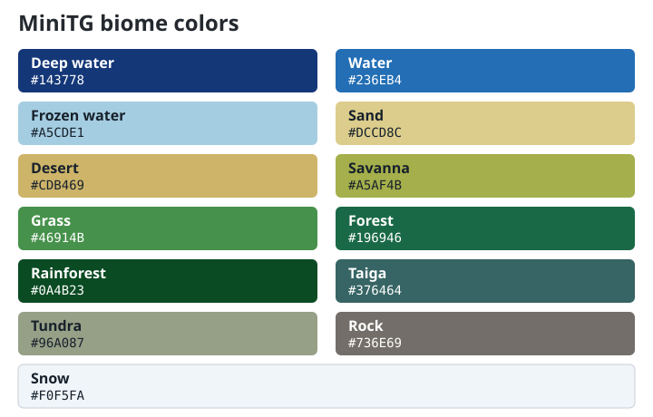

# MiniTG

MiniTG is a simple top-down biome and terrain generator.

It uses deterministic, coordinate-hashed value noise with smooth interpolation
to generate elevation values. Multiple noise octaves are combined using fractal
Brownian motion (fBm), adding progressively finer terrain detail before each
elevation is combined with moisture and temperature to classify each cell as
one of 13 terrain types.

A single world seed controls terrain generation. The elevation field uses the
world seed directly, while the generator derives separate deterministic seeds
for the moisture and temperature fields. This keeps all three maps tied to the
same world seed without giving them identical noise patterns. The application
can display the resulting terrain, moisture bands, temperature field, or
grayscale elevation bands.

An optional island falloff gradually lowers elevation toward the edges of the
map, creating a central landmass surrounded by water. Its radius and strength
can be adjusted from the terrain settings panel.

## Biome colors

The terrain view uses the following colors:



## Terrain classification

Elevation, moisture, and temperature are normalized to the range `0.00` to
`1.00`. The table below describes classification with the default settings;
the thresholds can be changed in the terrain settings panel. `Any` means that
the value does not affect that terrain type.

| Terrain type | Elevation | Moisture | Temperature |
| --- | --- | --- | --- |
| Deep water | `< 0.25` | Any | `>= 0.35` |
| Water | `>= 0.25` and `< 0.40` | Any | `>= 0.35` |
| Frozen water | `< 0.40` | Any | `< 0.35` |
| Sand | `>= 0.40` and `< 0.45` | Any | Any |
| Desert | `>= 0.45` and `< 0.70` | `< 0.45` (dry) | `>= 0.50` (hot) |
| Savanna | `>= 0.45` and `< 0.70` | `>= 0.45` and `< 0.65` (moderate) | `>= 0.50` (hot) |
| Grass | `>= 0.45` and `< 0.70` | `< 0.65` (dry or moderate) | `>= 0.35` and `< 0.50` (temperate) |
| Forest | `>= 0.45` and `< 0.70` | `>= 0.65` (wet) | `>= 0.35` and `< 0.50` (temperate) |
| Rainforest | `>= 0.45` and `< 0.70` | `>= 0.65` (wet) | `>= 0.50` (hot) |
| Taiga | `>= 0.45` and `< 0.70` | `>= 0.45` (moderate or wet) | `< 0.35` (cold) |
| Tundra | `>= 0.45` and `< 0.70` | `< 0.45` (dry) | `< 0.35` (cold) |
| Rock | `>= 0.70` and `< 0.85` | Any | `>= 0.35` |
| Snow | `>= 0.85`, or `>= 0.70` and `< 0.85` when cold | Any | Any at `>= 0.85`; otherwise `< 0.35` |

The default named bands are dry (`< 0.45`), moderate (`>= 0.45` and
`< 0.65`), and wet (`>= 0.65`) for moisture; and cold (`< 0.35`),
temperate (`>= 0.35` and `< 0.50`), and hot (`>= 0.50`) for temperature.


## Building

Requirements:

- CMake 3.27+
- Ninja
- A C++20 compiler

```sh
cmake --preset debug
cmake --build --preset debug
.\build\debug\minitg.exe
```
